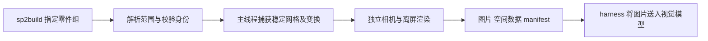

# SimplePlanes 2 零件外观与空间视觉检查方案

日期：2026-10-02。状态：**0.3.0 已实现首版视觉检查并完成本机验收**。正式调用契约见 [视觉检查手册](Visual-Usage.md)，验证范围见 [Verification.md](../Verification.md)。关联 [需求 v0.6](../../docs/SP2AgentBuildAssistant-Requirements.md)。下文保留立项时的源码调研和接口草案；草案中的后续能力不代表已交付。

实施选择：首版在 Unity 主线程复制原生登记的实际表面网格及其变换，在后台 CPU 进行正交光栅化，采用不透明双面、分组配色及简化光照，避免依赖原生 shader/材质替换及现场相机。已提供 resolve/capture/pick、联合三视图/斜视图、共同比例、局部放大图、ID PNG、投影/空间 JSON、会话校验、异步取消及有界缓存。未实现原生材质、深度/法线图、GLB、剖切或透明上下文。此选择能观察实际几何，但透明镂空 shader、贴花及 shader 变形仍需原生画面或后续渲染后端补充。

用户希望 Agent 能指定单件、多件或多个部件子树，直接了解其真实模型外观；同时查看多个独立目标时，需要保留其相对空间位置。建议新增“视觉检查包”：由游戏内 DLL 读取当前设计器的实际网格，离屏生成联合三视图与斜视图，由 CLI 返回图片及空间说明。需要辨认局部时，再提供编号、零件 ID 图和放大图。该方向已有明确源码基础，适合继续采用 `sp2build` 入口。

## 1 已确认的实现基础

立项调研阶段只读取本地代码、核对程序集并更新文档，没有执行旧渲染器或向游戏写入。游戏源码始终为只读参考；后续实施及实机测试记录见上方验收文档。调研时 Game.dll SHA-256 为 `3BAAAAC8B239210041F5E11F64D0505B87D0B497197D516BB64855DFAEEE524C`，与 [反编译基线](../../Game/DECOMPILATION.md) 中的 0.7.8.103 一致。

| 证据 | 已确认的能力 | 对新功能的含义 |
| --- | --- | --- |
| [OrthoScreenshotHelper](../../Game/Assets/Scripts/UI/Sharing/OrthoScreenshotHelper.cs) 的 `TakeOrthoScreenshots` | 原生创建 `Designer/OrthoCamera`，通过 RenderTexture 生成 720×720 顶、前、侧视图；包围盒包含断开零件 | 三视图有现成基础；该入口面向整机，不能直接满足任意零件集合 |
| [ColorToolAutoPaint](../../Game/Assets/Scripts/Design/Tools/ColorToolAutoPaint.cs) | 按 Part 的 RendererMaps 遍历网格，使用真实 `localToWorldMatrix` 和 `_PartID` 绘制；处理负缩放及标签网格 | 可以沿用零件与渲染网格对应的思路，单独绘制指定目标并识别图中零件 |
| [DragCalculatorScript](../../Game/Assets/Scripts/Craft/DragCalculatorScript.cs) 的 `RenderDrag` | 正交相机、CommandBuffer、目标与遮挡网格分开绘制 | 多角度定向投影、遮挡分析有游戏内使用先例；阻力图本身不代表完整外观 |
| [PartMaterialScript](../../Game/Assets/Scripts/Craft/Parts/PartMaterialScript.cs) | RendererMaps 提供 Mesh、Renderer、子网格材料映射；存在材质属性块和独立高亮绘制 | 需要同时处理网格、变换、材料及标签，单查 Collider 不够 |
| [旧 CraftRenderer](../../BepInExPlugins/SP2CraftBridge/src/CraftRenderer.cs) | 已尝试整机多视角、mask、Part-ID、深度/法线及 manifest | 相机取景和文件组织可参考；此实现本次未验证，不能作为新工具已支持的功能 |
| [DesignerGeometry](../bridge/DesignerGeometry.cs) 与 [BuildRuntime](../bridge/BuildRuntime.cs) | 当前插件已有几何等待、状态身份和主线程任务队列 | 可承接视觉只读任务，但需新增异步读取分支、稳定快照及资源生命周期 |

原生三视图方法会创建编辑器 Collider；旧渲染器的 Part-ID 路径会暂时替换现场 Renderer 的材料，且主要按整机取景。新功能应独立实现只读采集与离屏绘制，不直接将这些方法包装为通用目标渲染命令。

## 2 建议交付的外观载体

| 载体 | 帮助 Agent 回答的问题 | 建议阶段 |
| --- | --- | --- |
| 联合正交三视图 | 外形轮廓、长度比例、左右/上下/前后位置 | 首版必需 |
| 联合斜视图 | 立体形态、表面过渡、三视图中重合目标的关系 | 首版必需，默认使用正交斜视 |
| 带组别和零件 ID 的标注图 | “看到的这一块对应哪个零件” | 首版必需；保留无标注原图 |
| 空间 JSON 与 manifest | 精确坐标、方向、范围、相机、图片与零件的对应关系 | 首版必需 |
| 离散 Part-ID 图与像素查询 | 精确将图像区域或像素映射回 partId | 首版推荐，按需输出 |
| 单组或单件放大图 | 观察小部件、翼型边缘、倒角等细节 | 首版推荐，始终附联合总览 |
| 深度图、法线图、轮廓/截面 | 进一步分析遮挡、表面方向、实际截面 | 后续；需定义数值编码与精度 |
| GLB 等可旋转模型 | 在支持模型查看器的平台交互观察和测量 | 后续；不是纯文本模型直接理解外形的保证 |

默认包建议包含一个三视图加斜视图的拼图、各视图原图和 manifest，避免每次把所有通道送给模型。分组颜色用于区分目标，原生颜色与分析配色必须注明；不能把分析配色当作飞机实际涂装。

三视图不能显示所有凹面与内部结构。目标被遮挡时，可增加背面/底面、指定方向或局部隔离图。透明上下文和透视穿透视图必须标记为分析效果，不能冒充真实可见外观。首版不承诺完整工程制图或从图像证明精确碰撞间隙。

## 3 目标范围与子树定义

目标解析与渲染分开。建议 `visual resolve` 返回每组完整 `partIds`、范围来源、外部连接、共享成员、被排除项及绑定的会话/修订。接着 `visual capture` 使用这一明确集合，或接受相同的内联选择器并返回解析结果。解析无需额外人工批准。

| 选择方式 | 建议语义 |
| --- | --- |
| `parts` | 精确指定零件 ID 集合，默认不扩展连接或对称件 |
| `selected` | 在执行时解析当前玩家选中零件；无选择时返回明确结果 |
| `craft` | 当前飞机的全部零件，包括独立的未连接部分 |
| `assembly` | 原生归属明确的组件，如程序化导弹及子件、机翼及控制面；输出实际成员清单 |
| `branch` | 根零件加明确停止边界；仅在查询副本的连接图上切断指定边后计算可达集合，实际飞机不变 |
| `neighborhood` | 根附近的有限跳连接邻域；明确叫邻域，不称为子装配或物理支撑 |

一般部件“子树”不能直接等同于 Unity Transform 子对象或任意 BFS 结果。[PartGraph](../../Game/Assets/Scripts/Craft/Parts/PartGraph.cs) 本身按连接遍历，另有排除通向座舱的分支算法，但这不保证用户语义上的组件归属。图有环或跨接时，必须检查被切断边的外部端点是否仍可绕路到达，遇到这种歧义返回 `scope_ambiguous`，附范围和边界问题，要求补充边界或改用显式集合。

边界至少标识连接两端及对应挂点；不能只依赖数组索引，也不能只用两端 partId 区分可能的多条连接。设置 `maxParts` 等上限，超限明确拒绝，不静默截断。两个“独立组”若存在共享零件，默认报告组重叠；有意重叠的比较可显式允许，但同一网格只绘制一次并保留全部成员关系。

0.2.2 的 [AssemblyScope](../bridge/AssemblyScope.cs) 是面向安全删除的严格规则，会拒绝子件存在外部连接等情况。视觉读取可借鉴原生归属的发现逻辑，但不应不加区分地复用删除限制：可读但不宜级联删除的集合，仍应允许通过显式 `partIds` 查看。

## 4 保留独立目标的相对空间位置

**联合总览是多组请求的必需输出。**所有目标保持捕获时的真实位置、旋转和缩放，使用共同坐标系与共同中心取景。不能分别居中、统一缩放后把几张图拼起来当作原始装配关系，也不自动把挂点对齐。爆炸图如后续支持，必须作为另一个明确改变展示位置的视图。

建议默认使用设计器世界坐标，单位米，轴向沿 Unity 的 X/Y/Z；允许指定一个零件定义观察坐标系。参照零件的坐标框架只取平移和正交旋转，比例尺不继承其缩放。明确报告 frame 到 world 的变换，零件负缩放保留在模型变换中。“front”只表示沿所选框架的前轴观察，不推测任意载具的物理机头方向。

固定视图约定如下，向量均在所选框架内；相机位于目标中心对应正轴一侧。

| 视图 | 相机观察方向 | 画面上方 |
| --- | --- | --- |
| front | `[0,0,-1]` | `[0,1,0]` |
| right | `[-1,0,0]` | `[0,1,0]` |
| top | `[0,-1,0]` | `[0,0,1]` |

每张图返回自己的相机矩阵和屏幕轴向，避免把前视图的屏幕左右误当作世界 X 正负。正交面板采用相同 pixelsPerMetre：将联合范围投影到各观察方向，取能容纳所有面板的最宽松尺度，再统一加边距。局部放大图允许不同尺度，但必须标明比例和总览中的定位范围。

manifest 至少提供：各组及零件的原始变换、所选框架下的包围盒、组中心定义、组间中心位移、每张图的投影矩阵、近远裁面、像素尺寸和比例。二维框分别标记“全几何投影范围”和“实际可见像素范围”；完全遮挡时保留零件记录并标记 `occluded`，不能当作零件不存在。

例如两组的世界包围盒中心分别为 `[-2,1,0]` 与 `[2,1,0.5]`，JSON 应明确 B 相对 A 的中心位移为 `[4,0,0.5]` 米。该值描述包围盒中心，不能称为挂点间距或表面净空。图像用于辨认外形，中心位移、轴向范围与真实表面距离分别定义；包围盒相交也不能直接证明网格相交。

可提供 `context:none|craft`：前者只绘制目标，后者补一张包含整机淡色轮廓的定位图。上下文不改变目标自身的坐标和大小；如需使用不同取景范围，应作为独立图片并报告不同尺度。它帮助定位挂架位于哪片翼下，但不能据此自动声明唯一受力支撑件。

## 5 游戏内渲染与一致性方案

建议流程如下：



1. 在当前 DLL 主线程队列新增异步视觉任务；等原生网格生成完成，校验会话及可选 expectedRevision。复用现有几何等待思路，但补充目标网格、材料、可见状态的采集检查。
2. 按零件获取实际 RendererMaps、MeshFilter 和必要的独立标签渲染项，处理子网格与负缩放。捕获世界变换及材质属性块；遇到共享 Renderer 或合并网格，必须保留准确归属或返回不支持，不能随意把全部几何归给其中一件。
3. 建立不可变的渲染快照，所有视图读取同一份内容。可使用无脚本的网格代理/私有 Mesh 副本；不能实例化整套 PartScript，以免触发构建、连接或材料更新副作用。不可读网格、蒙皮、粒子等按实际支持分类，无法可靠捕获时返回具体缺项。
4. 使用独立相机或 CommandBuffer 向离屏纹理绘制目标。首版优先实现能清晰显示实际表面的分析着色、组颜色、轮廓和 ID 通道；原生涂装、透明、贴花及光照分开适配和验证。
5. 渲染结束交付文件；取消、异常和超时均释放临时相机、Mesh、Material、RenderTexture，恢复必要的临时全局渲染状态。不修改现场材料、显隐、相机或选择，不产生撤销记录。

`CommandBuffer.DrawMesh` 允许指定 Mesh、变换、子网格、材质和属性块，但 Unity 明确说明它不会自动设置光照所需数据。因此，直接把原生材质交给该接口，并不足以承诺与游戏画面一致。分析着色应使用明确的独立着色器；原生外观可研究隔离的无脚本代理场景和独立光照，并逐项验收。[Unity DrawMesh 文档](https://docs.unity3d.com/6000.0/Documentation/ScriptReference/Rendering.CommandBuffer.DrawMesh.html)

独立禁用相机可手动渲染至目标纹理；需要避开相机自身正在渲染时重入，并确认当前游戏渲染管线兼容性。[Unity Camera.Render 文档](https://docs.unity3d.com/6000.0/Documentation/ScriptReference/Camera.Render.html) 如支持蒙皮网格，可在捕获时烘焙当前姿态，需计入 CPU 成本。[Unity BakeMesh 文档](https://docs.unity3d.com/6000.0/Documentation/ScriptReference/SkinnedMeshRenderer.BakeMesh.html)

当前 XML revision 不覆盖所有临时外观变化，例如编辑器隐藏状态或渲染时的动态姿态。视觉包应增加 `captureId`、`geometryStamp`、捕获帧和可见性策略，不能仅用 revision 作为图片缓存键。捕获过程中对象改变则拒绝或重新采集；成功冻结后玩家继续操作，不影响该包自洽，但应报告交付时是否已落后于当前修订。

默认沿用设计器的可见性，对隐藏目标在 manifest 中说明原因。可选 `includeHidden` 只能从真实存在的几何创建离屏代理，不修改玩家显隐；无网格或不支持的对象明确报告。分析 ID 通道应约定透明表面的命中策略，例如取最近几何表面，不能把它冒充与透过玻璃看到的彩色像素完全一致。

ID 图采用离散索引与 partId 对照表，关闭抗锯齿、后处理、色调映射和有损压缩；不得将普通彩色图近似量化后当作精确 ID。深度图若后续实现，应输出单位米、有效 mask、近远裁面及编码规则。OpenGL/Direct3D 投影差异、纹理上下翻转和像素原点通过已知几何校准，不靠矩阵公式猜测。

性能方面建议首版限制像素总量、视图数、网格总量和并发任务，按需生成额外图层。GPU 异步读回可减少等待 GPU 带来的停顿，但会增加数帧延迟，仍需处理设备支持和失败回退；这不是整个渲染过程无开销的保证。[Unity AsyncGPUReadback 文档](https://docs.unity3d.com/6000.0/Documentation/ScriptReference/Rendering.AsyncGPUReadback.html) 首版先实测 350 件级和更大载具的耗时、帧停顿及显存占用，再确定默认预算，不预先承诺速度。

## 6 CLI 接口草案

**本节命令尚不存在，不能直接用于当前 0.2.2。**最终名称与字段以实现后的 `commands schema` 和 `capabilities` 为准。建议增加以下只读接口，继续复用现有 operation 状态、等待与取消机制。

| 草案命令 | 职责 |
| --- | --- |
| `sp2build visual resolve` | 解析多个目标组及边界，返回成员清单与范围问题 |
| `sp2build visual capture` | 生成联合视图、可选局部图及 manifest |
| `sp2build visual pick` | 按 captureId、视图和像素查询捕获时的 partId、groupId；旧包标记为旧状态 |

以下输入演示两个明确的零件组，ID 只是示意，实际使用前须从当前会话查询。关联 `craftSessionId`，避免旧 ID 指向另一架飞机。`expectedRevision` 在希望严格锁定观察状态时提供；用户只想查看最新状态时可省略该字段，仍需绑定会话并返回实际 revision。

```json
{
  "craftSessionId": "session-from-current-snapshot",
  "expectedRevision": 12,
  "groups": [
    {"name": "left-pod", "selector": {"kind": "parts", "partIds": [101, 102]}},
    {"name": "right-pod", "selector": {"kind": "parts", "partIds": [201, 202]}}
  ],
  "frame": {"kind": "world"},
  "views": ["front", "right", "top", "isometric"],
  "projection": "orthographic",
  "scaleMode": "shared",
  "resolution": {"width": 1024, "height": 1024},
  "style": "analysis",
  "context": "none",
  "channels": ["color", "annotated", "partId"],
  "details": "perGroup",
  "includeHidden": false
}
```

建议调用形态：

```powershell
# 未来接口示例；当前版本不可执行
sp2build visual capture --input visual-request.json --output-dir .\inspection --output .\inspection-result.json
```

`--output` 沿用现有 CLI 的 JSON 输出语义；新增 `--output-dir` 为本地图片/模型目的目录。DLL 返回有界产物标识，经带令牌的本地接口取回；由 CLI 将文件写入用户指定目录。stdout 保持简短 JSON，不塞入图片 Base64 或全部网格顶点。只有全部必需文件写完才报告完整成功；文件丢失或超预算明确返回失败或带缺项的 partial 状态。

建议响应包括下列字段；此为缩略格式示意，不是本机实测输出，实际路径由 CLI 解析成绝对路径。

```json
{
  "success": true,
  "schemaVersion": "1",
  "data": {
    "captureId": "visual-example",
    "identity": {"craftSessionId": "session-from-current-snapshot", "revision": 12},
    "geometryStamp": "geometry-stamp-example",
    "complete": true,
    "staleAtDelivery": false,
    "frame": {"kind": "world", "units": "metres", "axes": "Unity X Y Z"},
    "groups": [
      {"name": "left-pod", "partIds": [101, 102], "boundsCenter": [-2, 1, 0]},
      {"name": "right-pod", "partIds": [201, 202], "boundsCenter": [2, 1, 0.5]}
    ],
    "relations": [{"from": "left-pod", "to": "right-pod", "basis": "world_bounds_centers", "deltaMetres": [4, 0, 0.5]}],
    "manifestPath": "C:/inspection/visual-example/manifest.json",
    "recommendedImages": ["C:/inspection/visual-example/overview.annotated.png"],
    "warnings": []
  }
}
```

完整 manifest 再保存每图的 cameraToWorld、投影/像素变换、frameToWorld、比例尺、每个零件变换与范围、ID 对照表、可见性及遗漏原因，说明矩阵行列顺序、像素原点和索引起点。图片文件记录 MIME、宽高、用途和 SHA-256。对多个相距很远的目标，保留总览并报告细节像素不足，推荐相应局部图，不偷偷改变它们的相对位置。

## 7 Agent 如何真正读取这些载体

CLI 产生文件只是链路的前半段。Agent 平台必须能读取本机图片，并把它作为图像输入交给支持视觉的模型。shell 输出里的文件路径、Markdown 图片引用或 Base64 文本，不保证自动触发这一步；skill 也不能替平台增加视觉能力。本次未核查 DSH 的模型配置与图片工具，不能断言它当前已经具备该能力。

未来 skill 应采用明确流程：解析目标并捕获 → 读取 `recommendedImages` → 调用平台已有图片查看/附件接口 → 综合图像和空间 JSON 分析 → 必要时补视角或放大图 → 使用当前修订执行编辑 → 重新捕获验证。需要将图中区域转为编辑目标时，用 ID 图或 pick 校验，不能单凭外观猜 partId。

若 DSH 只有纯文本模型，可继续读取几何范围、变换和数值分析；要获得外形视觉判断，应配置视觉模型或由 harness 调用一个视觉分析工具，将同一检查包连同任务送入。GLB、OBJ 或大量顶点文本不会自动解决纯文本模型的视觉能力限制。MCP 可选地承载图片内容，但本需求不需要更换 CLI 架构。

## 8 实施顺序与验收

建议分两阶段。首版完成目标集合解析、联合三视图与斜视图、清晰的真实几何分析着色、组/零件标注、空间 JSON 和图片接入流程；同时实现局部图及精确 ID 通道。原生材质完全还原、任意截面、深度/法线、网格导出与交互模型查看器后续逐项扩展。只读视觉范围不应复用写操作造成的载具重建。

| 验收场景 | 通过条件 |
| --- | --- |
| 单个复杂 Fuselage、异形机翼和控制面 | 裁剪、曲面、开口、翼型与当前渲染模型一致；修改后捕获显示新几何 |
| 两个独立组、不同旋转及负缩放 | 总览保留相对位置和真实尺度；各正交图比例相同，镜像不丢面 |
| 三视图中存在投影重合 | 斜视/补充方向和坐标解释正确；不把投影重叠误报为三维重合 |
| 原生组件、通用分支及环路 | 解析成员可核对；外部边界绕路、组重叠、超限有明确结果 |
| 遮挡、隐藏、透明表面、标签和不支持的渲染器 | 可见性语义一致，未渲染项不静默消失；ID 与外观的策略差异有说明 |
| 修改后立即读取、读取期间玩家修改、切换飞机 | 同一包为同一几何状态；过期会话被拒绝，变化检测与缓存失效有效 |
| 连续捕获、取消和错误 | 当前飞机、历史、相机、选择、显隐和材质无副作用；无持续资源增长 |
| CLI 及 harness 端到端 | JSON 与文件一致，路径可读取，模型实际收到图片，并正确指认至少两个编号目标及其相对方位 |
| 多视图像素校准 | 已知三维点投影落在预期像素，ID 边缘不混色；矩阵、深度方向和图像上下方向一致 |

难度判断：联合正交视图和范围解析为中等工程量；可靠的原生材料还原、透明/贴花及特殊 Mod 渲染覆盖难度较高。新功能可在现有独立 DLL 和 CLI 上增量实现，首次部署新 DLL 仍需游戏重启。当前仅完成需求与方案，未将草案命令加入运行时 capabilities、现有 skill 或发布包。
